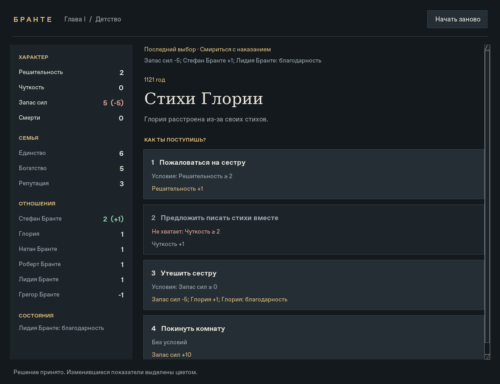

# Бранте: «Детство»

Играбельная реконструкция первой главы «Жизни и страданий господина Бранте»
по загруженным руководствам Steam и `Brante.ods`.
**14 событий, 44 варианта**, включая «Отцовскую шпагу» и «Муравьиную ферму».
Поздних глав нет. Художественные сцены заменены короткими описаниями.



## Запуск

Нужен Python 3.10 или новее с Tkinter. В Windows и macOS Tkinter обычно
установлен вместе с Python; на Debian/Ubuntu при необходимости:
`sudo apt install python3-tk`. Внешние Python-пакеты и сеть для игры не нужны.

```sh
cd /workspace/just_for_fun
python3 -m brante
```

На своём компьютере после распаковки откройте терминал в папке `just_for_fun`
и выполните `python3 -m brante` (на Windows: `py -m brante`).

Откроется графическое окно: слева постоянная панель характеристик, семьи
и отношений, справа событие и карточки решений. Выбирайте мышью или клавишами
1–4. Недоступные варианты приглушены; рядом показано, чего не хватает.
После хода изменившиеся показатели выделяются цветом, а над событием
остаётся результат последнего выбора. Кнопка «Начать заново» или Ctrl+R
сбрасывает прохождение. В небольшом окне панели можно прокручивать колесом.

В игре нет примечаний о расхождениях ODS и руководств: они оставлены
в документации. В конце показаны итоговые характеристики и свершения.

Терминальный режим сохранён отдельно: `python3 -m brante --cli`.
В нём выбирайте номер варианта; `q` завершает прохождение.

Если в Linux нет дисплея, используйте `--cli`. Если особая сборка Python
не отображает кириллицу в Tk, используйте системную: `/usr/bin/python3 -m brante`.

Можно задать собственные цели, чтобы увидеть, удалось ли их достичь:

```sh
python3 -m brante --goal 'Урок фехтования' --goal 'Причастие дворянина'
```

Это личные цели прохождения: недостигнутая цель не выдаётся за оригинальную
концовку игры. Малая смерть от руки деда не завершает прохождение. Отсутствие
«Причастия дворянина» не закрывает будущий путь дворянина.

```sh
python3 -m brante --list-events
python3 -m brante --audit
python3 -m unittest discover -s tests -v
```

Тесты окна запускаются при наличии дисплея и Tkinter; без дисплея они
явно пропускаются. Для графической проверки в этой облачной среде
использован системный Python с Tk 8.6 и виртуальный X-сервер.

## Что восстановлено и насколько точно

- Требования к характеристикам, благодарность персонажей, условия ИЛИ.
- Изменения сил, характера, отношений, семьи; свершения и малая смерть.
- Однократные дополнительные события по достижению 4 решительности/чуткости,
  с возвращением к основной цепочке.
- Все 44 варианта достижимы в проверенных модельных прохождениях.
- Три маршрута воспроизводят итоговые решительность, чуткость и запас сил,
  указанные в независимых руководствах: **5/5/0**, **6/1/5**, **6/6/0**.

**Это реконструкция по руководствам, а не подтверждённая копия правил игры.**
ODS содержит пропуски и противоречия; решения по ним перечислены в
[разборе источников](docs/sources.md). Начальные семейные показатели взяты из
ODS. Фоновые изменения вне выборов, границы характеристик и точные возрастные
окна дополнительных событий ещё нужно сверить с оригинальной игрой.
Отрицательный запас сил разрешён намеренно: условие проверяется **до** траты,
поэтому при 0 можно сделать разрешённый выбор стоимостью 5 или 10.

[Полный каталог событий и вариантов](docs/childhood.md) можно читать без запуска.
Краткий контекст написан по названиям и вариантам; это не оригинальный текст сцен.

## Данные и источники

- `data/childhood.json` — правила главы отдельно от движка.
- `data/sources/manifest.json` — названия, URL и SHA-256 всех 19 HTML и ODS.
- `data/sources/steam-*.json` — извлечённые разделы детства, без интерфейса Steam.
- `data/sources/ods-childhood.json` — строки таблицы до начала отрочества,
  включая скрытые группы и повторяющиеся пустые ячейки.
- `tools/extract_sources.py` — повторяемое извлечение свидетельств из загрузок:

```sh
python3 tools/extract_sources.py /workspace/attachments data/sources
```

Извлечение не загружает сеть и не исполняет скрипты HTML. Оно сохраняет
исходные сведения; расхождения в игровые правила автоматически не превращает.
Для изменений правил редактируйте `data/childhood.json` и проверяйте тесты.

У варианта есть `requirements`, `effects`, `next` и ссылки `source`.
Требования `stat_min`, `stat_max`, `flag` объединяются через И;
`any` содержит альтернативы через ИЛИ. Пустой список требований означает
отсутствие ограничений по принятым источникам. `null` означает неизвестные
правила и блокирует выбор. Последствия `stats` прибавляют числа, `flags`
присваивают состояния. `next: null` завершает главу; `$resume` возвращает
из дополнительного события к прерванной основной цепочке.
